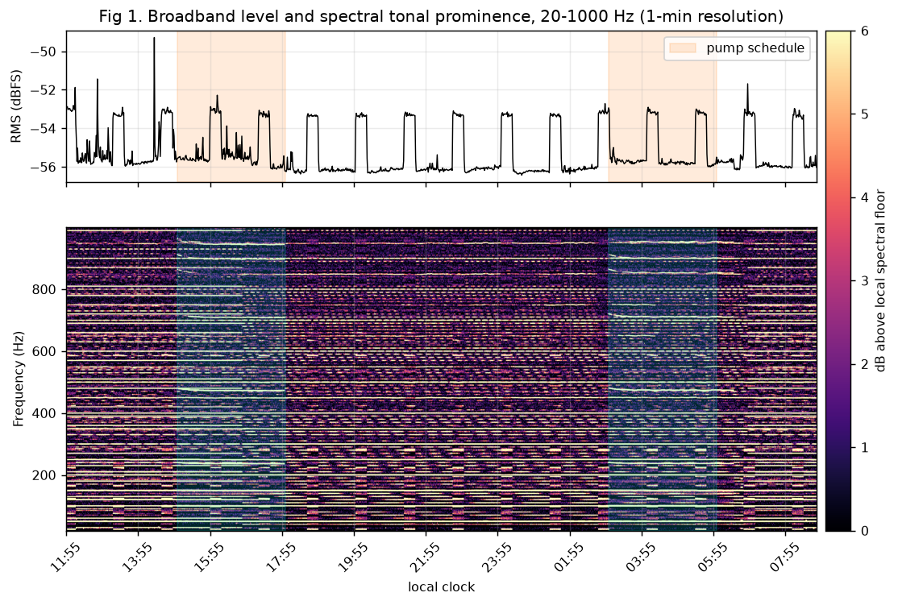

# camera-audio-machine-detect

Detect faint, schedule-driven machines (a ventilation fan, a pool pump) - and, as a work in progress, vehicles - from the
audio (and, where useful, the video) of an ordinary IP camera's RTSP stream, using per-minute spectra, schedule-supervised
matched filtering and a period-free box-least-squares search.

* **[REPORT.md](REPORT.md)** - full technical report: method, maths, statistics, figures
* **[docs/VEHICLES.md](docs/VEHICLES.md)** - vehicle detection (audio + video): design, hardware limits, roadmap
* [README.fa.md](README.fa.md) - Persian summary
* `hvac_listen.py` - capture (`record`), learn + report (`analyze`), live detection (`monitor`), stream check (`probe`)
* `analysis/make_report.py` - reproduces every figure/number from the anonymised data
* `data/features_20-1000Hz_anon.npz` - 20.9 h of per-minute spectra (no audio, no dates, no addresses)



## Why sound? (the motivation)

We had **no physical access** to the pool pump or to the fan (both are in places we cannot reach or instrument; there is no
power meter, no switch, no vibration sensor). The only sensor within reach was a camera that already hears the building. So the
question became: *can we tell that a machine is running, and when, purely from a faint microphone signal?*

Because we cannot observe the machines directly, there is **no ground truth**. The method therefore uses the owner's
*believed* schedules as weak labels, validates them with held-out and permutation tests, and - when the data contradict the
belief - falls back to a period-free search. That is why the report is careful to say "detected", "consistent with" or
"unconfirmed" rather than "proved".

## Current results (20.9 h of data)

| Source | Result | Status |
|---|---|---|
| Pool pump (believed ON 03-06 and 15-18) | detected: schedule agreement 95.8 %, block-permutation p = 0.003, held-out d' 1.6-1.8 | supported by two events; more days needed |
| Fan (believed 20 min ON / 40 min OFF per hour) | **not detected under that schedule** (no hourly structure; detection limit ~1.2 dB per line) | negative result, not proof of absence |
| A perfectly regular periodic source: 80.92 +- 0.04 min period, ON 18.9 min | found without assuming a period (BLS p = 0.003) | **unconfirmed** whether it is the fan; needs a ground-truth switch event |

**This README and the report will be updated as soon as the fan is identified (or ruled out) with more data or a switching
test.**

## Vehicles (work in progress)

The goal is to recognise cars, motorcycles, trucks and tractors - near or far, passing or standing with the engine running -
from the audio, with the camera image as a second sensor, and if possible to estimate type, colour and model.
See [docs/VEHICLES.md](docs/VEHICLES.md). What exists today: a 0.5 s audio feature log (`fine.bin`) written by the recorder.
What is planned: event segmentation, engine-harmonic features, video-as-teacher labelling, off-device make/model review.

### Hardware limits we design around

* Raspberry Pi 3 Model B (4 x 1.2 GHz Cortex-A53, ~0.9 GB RAM), power supply currently under-volting.
* Camera audio is G.711 mu-law, 8 kHz mono (band < 4 kHz, ~-55 dBFS typical); video is 720p H.264 behind a railing, so vehicles
  are often small or hidden; night images are IR/monochrome (no colour).
* The camera tolerates essentially one RTSP session; everything shares one `ffmpeg`.
* Frames never leave the device or enter this repository (privacy); only derived numbers do.

## Quick start

```bash
pip install -r requirements.txt
python analysis/make_report.py            # regenerate figures + results.json
```

On your own camera (only cameras you own or are authorised to access):

```bash
export RTSP_USER=<user> RTSP_PASS='<password>' RTSP_HOST=<camera-ip> RTSP_PATH=/<stream-path>
python hvac_listen.py probe
nohup python hvac_listen.py record --out data &     # writes feat.bin (minute spectra) and fine.bin (0.5 s log)
python hvac_listen.py analyze --out data --utc-offset 60   # fan period is found automatically
```
