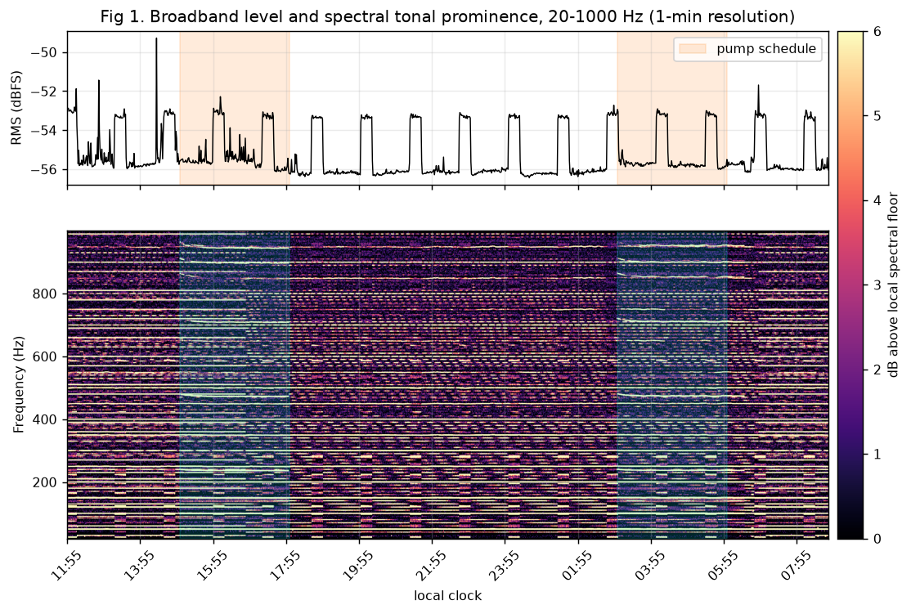
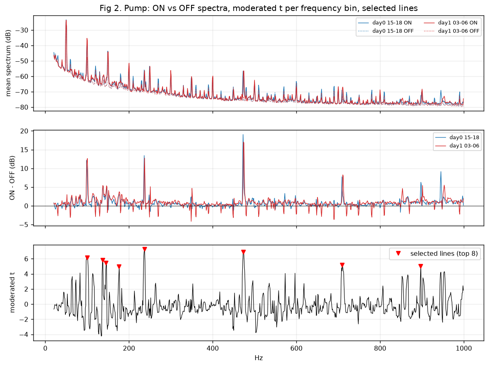
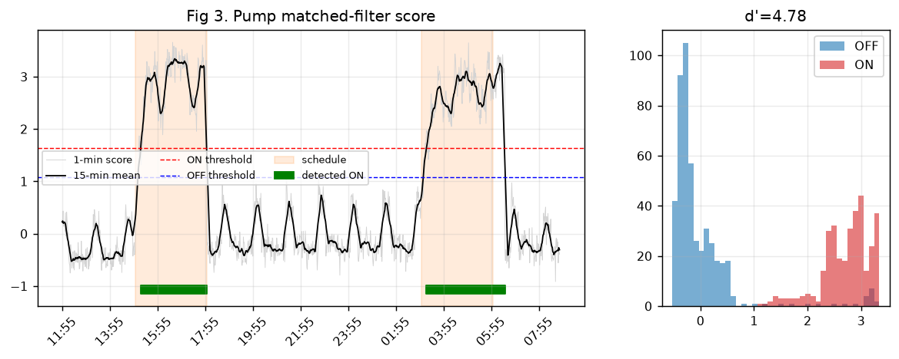
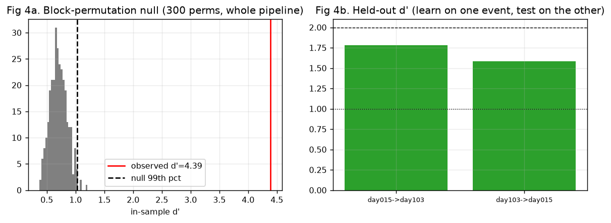
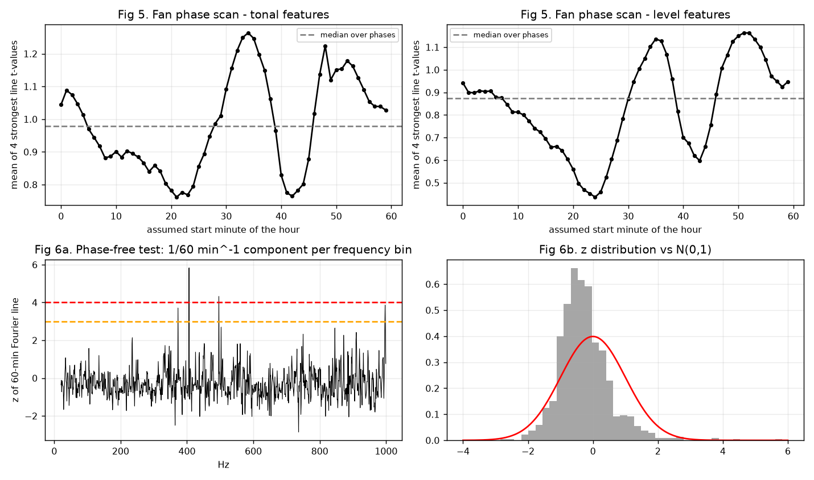
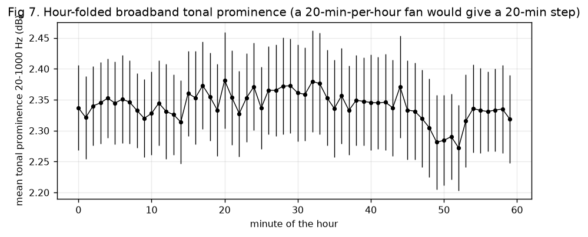
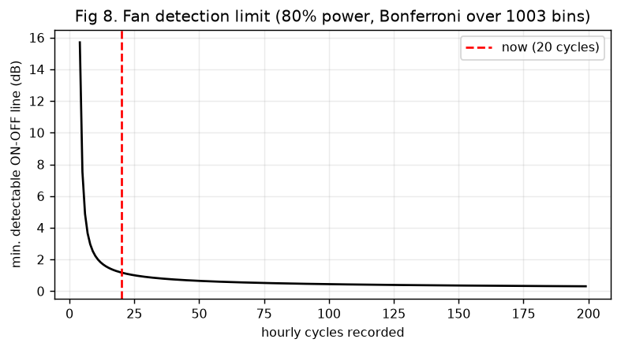
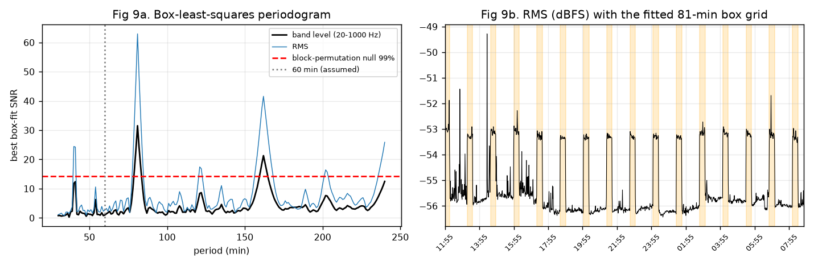
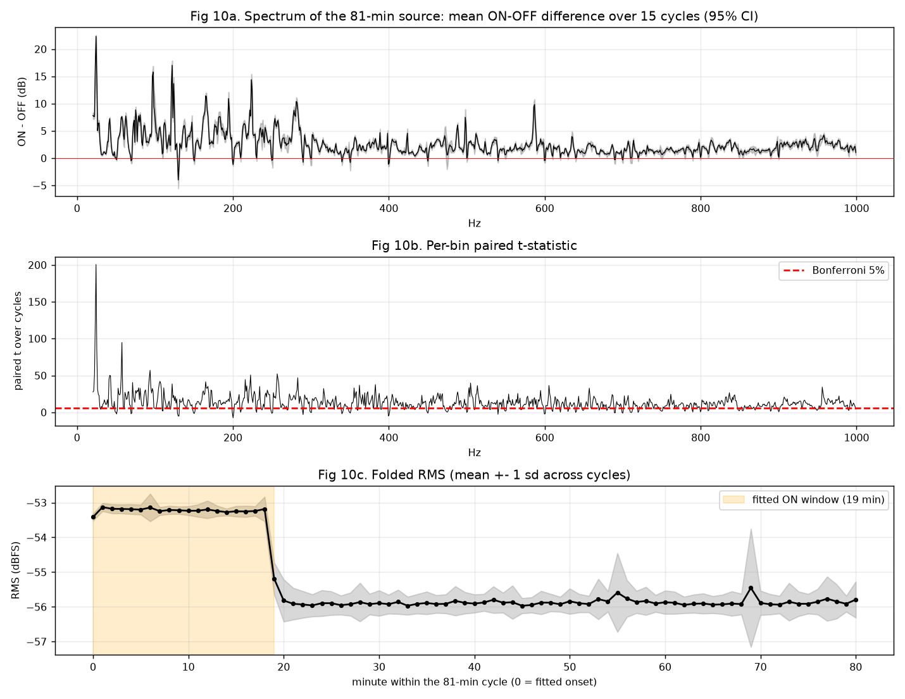
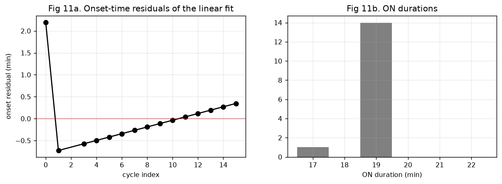

# Finding faint machine sounds in a camera's RTSP audio

*Technical report. Everything below is reproduced by `python analysis/make_report.py` from the anonymised
dataset in `data/` (numbers in `results.json`, figures in `figures/`).*

**Goal.** Using only the audio track of an IP camera, detect and log two machines that are not in the room:

| Source | Believed schedule (from the owner) |
|---|---|
| Ventilation fan, one floor below | 20 min ON / 40 min OFF, every hour |
| Swimming-pool pump | ON 03:00-06:00 and 15:00-18:00 |

**Data.** 1 253 consecutive minutes (20.9 h, 100 % coverage, local clock), two pump windows
(15-18 on day 0, 03-06 on day 1).

## 1. Summary of results

| Question | Result | Evidence |
|---|---|---|
| Is the **pool pump** audible? | **Probably, pending ground truth.** The 3 h windows differ from their flanks in many narrow lines, ON/OFF segmentation agrees with the believed schedule on 95.5 % of minutes. | in-sample d' 4.8; block-permutation p = 0.003 (this tests *'the middle 3 h differ from the flanks'*, not *'a pump'*); cross-event held-out d' 1.78 / 1.58 (moderate; n = 1 event per direction, no CI) |
| Is there a periodic machine matching the **fan**? | **A very regular periodic source exists, but its period is 81 min, not 60 min**: ON about 19 min, OFF about 62 min. | BLS SNR 31.5 (null 99 % = 14.2, p = 0.003, 300 permutations); the same peak on RMS; onset jitter 0.7 min |
| Does the believed *hourly* fan schedule appear? | **Not found.** | BLS at P = 60 min is far below the peak at 81 min (Fig 9a); hour-folded profile flat to 0.11 dB; detection limit ~1.2 dB per line |
| Is the 81-min source *the* fan? | **Unconfirmed.** ON length (19 min) matches "20 min", the period does not. | needs a ground-truth switch event (see section 7) |



*Fig 1.* The 81-min source is plainly visible even in the broadband level (top, rectangular +2.7 dB pulses); the
pump is invisible in the level but shows up as many narrow spectral lines (bottom, shaded windows).

## 2. Acquisition

* Camera audio: **G.711 mu-law, 8 kHz, mono, 64 kbit/s**, pulled over RTSP/TCP by `ffmpeg` and decoded to s16le.
  Mean level -55.2 dBFS (sd 1.2 dB, min -56.4, max -49.3). The noise floor of the minute spectra is -47.7 dB at 100 Hz,
  -63.3 dB at 500 Hz, -76.3 dB at 1 kHz (per 1 Hz bin, relative to full scale).
* Wall-clock minute buckets; a minute is kept if >= 60 % of its samples arrived. A watchdog restarts the capture after
  25 s without data.
* Mu-law quantisation limits dynamic range (~38 dB SNR for loud signals, much worse for very quiet ones); machines
  quieter than the quantisation/room floor cannot be seen. Camera AGC / noise gating, if enabled, would remove faint sounds
  (not observed here: the machine pulses are stable in level).

## 3. Method

### 3.1 Per-minute transient-robust spectrum

For every minute, x is split into frames of N = 8192 samples (1.024 s, 0.98 Hz resolution) with hop N/2 and a Hann window w:

```
P[f,k] = |FFT(w . x_f)[k]|^2 / sum(w^2)          f = 1..~117 frames
S[k]   = 10 log10( Q25_f P[f,k] )                 25th percentile over frames
```

The 25th percentile (instead of the mean) rejects speech, door slams and other transients, which occupy only a minority of
frames, while a stationary machine raises every frame. Bins 20-3500 Hz are stored (3 563 bins, 14.3 kB/min).

### 3.2 Features

* **tonal**: `Pi[t,k] = S[t,k] - median_{|j-k|<=20} S[t,j]`, followed by a 3-bin max-pool across frequency
  (tolerates about 1 Hz of motor-speed drift). Narrow lines (motor hum, blade-pass, bearings) stand out of a broadband floor.
* **level**: `L[t,k] = S[t,k] - median_t S[.,k]`, sensitive to broadband changes.

### 3.3 Matched filter learned from the schedule

For each cycle/event c a pair of disjoint minute sets is formed (ON, and the OFF minutes of the same or neighbouring period,
edge minutes trimmed). Per bin:

```
D[c,k] = mean_{t in ON_c} F[t,k] - mean_{t in OFF_c} F[t,k]
t_k    = mean_c D / ( (s_k + s0)/sqrt(n) ),   s_k = sd_c D[c,k],  s0 = median_k s_k      (moderated t, SAM-style)
```

The moderation term `s0` prevents bins with tiny sample variance from producing spurious huge t when n is small.
Lines are one-per-peak (local maximum over +-3 bins) with `t > median(t) + 5 . 1.4826 . MAD(t)`, at most 25.
With weights `w_k = t_k / sum t` and off-state mean/sd (mu_k, sigma_k):

```
score[t] = sum_k w_k (F[t,k] - mu_k)/sigma_k ,  smoothed by a boxcar (5 min fan, 15 min pump)
d'       = (mean_on - mean_off) / sqrt((var_on + var_off)/2)
```

ON/OFF state: Schmitt trigger at `m0 + 0.6(m1-m0)` / `m0 + 0.4(m1-m0)`, minimum duration and gap filling.
Pump events: each 3 h window is contrasted with the 2 h before and after (10 min guard, 6 min edge trim); pairing within an
event cancels slow ambient drift.

### 3.4 Period-free detection (box-least-squares)

When the schedule is wrong the matched filter has nothing to match. BLS needs no assumption: on the robust-standardised
band level `z = clip((y - med)/ (1.4826 MAD), +-4)` it folds the series modulo every period P in 30-240 min, slides a box of
L = 12-30 min over the P phase bins and maximises

```
SNR(P, phi, L) = ( mean_on z - mean_off z ) / sqrt( 1/n_on + 1/n_off )
```

Significance is the maximum SNR over *all* (P, phi, L) compared with the same maximum on series whose 30-min blocks are
randomly permuted (the correct family-wise null for a search over ~10^5 hypotheses).

## 4. Pool pump



*Fig 2.* ON vs OFF spectra for both windows (same lines in both, which is what a real machine does) and the per-bin
moderated t; selected lines marked.

Strongest lines (ON - OFF in the 25th-percentile spectrum, 95 % block-bootstrap CI, 15-min blocks, 2 000 resamples). Note: the
25th percentile of a noise-only bin sits about 5 dB below its mean, while a steady tone is not lowered by it, so these differences
are **upper bounds** of the change in mean level (by up to ~5 dB); the bootstrap CI also ignores between-event variance (n = 2) and line-selection bias.

| Hz | ON-OFF (dB) | 95 % CI |
|---:|---:|---|
| 100.6 | +10.1 | 8.3 - 11.6 |
| 137.7 | +5.4 | 4.3 - 6.5 |
| 145.5 | +3.9 | 3.0 - 4.7 |
| 237.3 | +11.0 | 9.3 - 12.5 |
| 473.6 | +15.9 | 12.5 - 19.2 |
| 710.0 | +4.8 | 3.1 - 6.6 |
| 897.5 | +3.8 | 2.7 - 4.9 |
| 176.8 | +3.4 | 2.3 - 4.4 |

The ~100 Hz line is 2 x the 50 Hz mains frequency: any 50 Hz load produces it, so it is **not** specific to a pump. The stronger
structural evidence is the harmonic series 237.3 : 473.6 : 710.0 = 1 : 2 : 3 (710.0/237.3 = 2.99), as expected from one rotating
source (for example the blade-pass frequency of an impeller and its harmonics). Identifying the mechanism needs more than this audio.



*Fig 3.* Matched-filter score. The segmentation (green) follows the believed schedule (orange); agreement 95.5 % of minutes.
(The agreement is partly circular because the schedule trained the filter; Fig 4 removes the circularity.)



*Fig 4.* (a) Whole-pipeline permutation test: ON/OFF 15-min block labels are shuffled inside each event 300 times and the
entire procedure (line selection with fixed K = 10, scoring, d') is repeated. Null mean 0.71, 99th pct 1.03, max 1.21;
observed 4.39 (top-10 lines), so p = 1/301 = 0.0033 (smallest value 300 permutations can give). The test asks whether the middle 3 h differ from the flanks; it cannot say that the cause is a pump. (b) Cross-event hold-out: lines
selected on the 15-18 window separate the 03-06 window with d' = 1.78 (AUC 0.91) and vice-versa d' = 1.58 (AUC 0.997).
Hold-out d' is lower than in-sample d', plausibly because each line set is estimated from a single event (n = 1 per
direction).

**Statistic used.** For n >= 3 events the moderated t of 3.3 is used; with n = 2 events (this data) `tvals` falls back to
`D / (sd_ref * sqrt(15/n_on + 15/n_off))`, a z-like score that assumes a ~15-min autocorrelation (the `t_moderated` field in
`results.json` is therefore a z-like score here). AUC 0.997 together with d' 1.58 is not consistent with Gaussian classes: the
scores drift inside each class (before vs after flank), so AUC is descriptive only.

**Caveat.** Only two events exist; the believed schedule is the label. A third and fourth event (tomorrow 15-18, 03-06) will
allow a proper leave-one-event-out estimate.

## 5. The "fan": what the data say

### 5.1 Under the believed schedule (20 min per 60 min) nothing is found



*Fig 5 (top)*: scanning all 60 start minutes, the best statistic (mean of the 4 strongest line t-values) is 1.26 (tonal) and
1.16 (level), barely above the median of the phase curve (0.98 / 0.87), i.e. no sharp phase peak. (The dashed lines in the figure come
from a block-rotation surrogate that is **not a valid null**: the wrap-around seam falls on the same minute-of-hour in every block
and injects coherent hourly structure; do not read p-values from it. The valid test is BLS at P = 60 min, Fig 9a.) *Fig 6*: a phase-free test of the 1/60 min^-1 Fourier component per bin gives 4 of 1 003 bins with z > 3 (1.35
expected) at inconsistent phases (minute 50, 34, 44, 44), i.e. no coherent hourly structure. *Fig 7*: the hour-folded
broadband tonal prominence varies by 0.11 dB (median SEM 0.07 dB).



Detection limit (Fig 8): with 20 hourly cycles, sd of the per-cycle ON-OFF difference 0.86 dB, Bonferroni alpha = 0.05/1003
and 80 % power, a line must differ by >= 1.17 dB to be detectable; 72 cycles (3 days) -> 0.53 dB, 168 cycles -> 0.33 dB.
So a hypothetical hourly fan weaker than ~1 dB in a spectral line is not excluded. (The Bonferroni factor covers frequency bins only,
not the search over 60 phases, so the true limit is somewhat higher.)



### 5.2 Without assuming the period, a strong periodic source appears



*Fig 9.* (a) BLS periodogram: a single dominant peak at **81 min** with aliases at 40.5, 121 (1.5 P), 162 (2 P), 202 (2.5 P) min, nowhere near 60 min. Band-level SNR 31.5 vs permutation-null 99 % of 14.2
(p = 0.003, 300 permutations); RMS gives 63.0 vs 28.9 (p = 0.01, 100 permutations). (b) The fitted 19-min boxes on the RMS.

Edge timing (15 pulses; the first one is the truncated pulse at the start of the recording and one slot, ~14:34, is not detected
in the RMS series (13:13 -> 15:55 = 2 P), so 'regular' means the 15 detected pulses fit the grid; linear fit `onset_k = a + P k`):

| Quantity | Value |
|---|---|
| Period P | **80.92 +- 0.04 min** (95 % CI 80.84 - 81.00) |
| Onset residual sd | 0.71 min |
| ON duration | 18.9 +- 0.5 min (n = 15) |
| OFF duration | 62.1 min |
| Duty cycle | 23.3 % |
| RMS step | +2.66 dB (-55.90 -> -53.24 dBFS) |

A residual sd of 0.7 min over 21 h, with a clean rectangular envelope, indicates a timer/controller, not an
environmental coincidence.



*Fig 10.* Spectrum of the source: ON-OFF difference averaged over 15 cycles with 95 % CI (a), paired t per bin (b), folded RMS (c).
It is **broadband**: +4.8 dB (20-100 Hz), +4.3 (100-300), +2.1 (300-600), +1.7 (600-1000); 88.6 % of bins differ at
p < 0.001 (paired t over cycles); the strongest bin is 24.4 Hz (+22 dB, t = 200), consistent with a large rotating machine; 24.4 Hz = 1 465 rpm, a plausible shaft speed of a 4-pole induction motor (96.7 Hz and 122.1 Hz
are close to its 4th and 5th harmonics, to be checked with more data). This remains a hypothesis. Learned signature lines: 24.4, 42.0, 57.6, 96.7, 122.1, 165.0, 222.7, 283.2 Hz.
Odd/even-cycle split d' = 16.5 / 16.5. **This is a consistency check, not independent validation**: the box labels come from a BLS fit
on the same data (band level) from which the spectral features are built; only the line selection is held out.



### 5.3 Interpretation

* The believed *hourly* schedule is falsified for this signal; the 81-min cadence is far from any rounding of 60 min.
* ON length 19 min matches "about 20 min", so a plausible reading is a timer with a ~20 min run followed by ~61 min rest
  (total ~81 min) rather than the believed 40-min rest.
* It could also be a different machine (heat-pump / compressor / air-handler). The data cannot discriminate, because no
  ground-truth edge exists.

## 6. Limitations

1. 20.9 h of data; two pump events; the pump labels are *believed*, not observed.
2. Minute-level spectra only; raw audio was not kept (privacy, and storage), so detectors based on sub-minute features
   cannot be added retrospectively.
3. The permutation nulls use block shuffles that ignore diurnal structure; the pump test is therefore not a test against
   all conceivable day/night confounders (the two windows are at different times of day, which is why the cross-event
   hold-out matters).
4. The block-rotation surrogate drawn in Fig 5 is not a valid null (section 5.1); the hourly hypothesis is judged by BLS at 60 min and
   by the detection limit.
5. Single microphone: no localisation, no distinction between machine and any other periodic source.

## 7. Next steps

* **Ground truth:** switch the suspected fan manually once (note the minute); if the 81-min cycle re-phases, it is the fan.
  Predicted next onsets from the fit: see `results.json` -> `periodic.edges.next_onsets_clock`
  (09:28, 10:48, 12:09, 13:30, 14:51, 16:12, 17:33 local on the day after the recording).
* Record >= 3 days: pump leave-one-event-out validation (needs >= 4 events), a fan detection limit of 0.5 dB, and
  verification that the 81-min cadence holds across day/night.
* Run `python hvac_listen.py monitor` for live ON/OFF events (writes `events_live.csv`).

## 8. Reproduce

```bash
pip install -r requirements.txt
python analysis/make_report.py            # figures/*.png + results.json  (~40 s)

# on your own camera
export RTSP_USER=<user> RTSP_PASS='<password>' RTSP_HOST=<camera-ip> RTSP_PATH=/<stream-path>
python hvac_listen.py probe
nohup python hvac_listen.py record --out data &
python hvac_listen.py analyze --out data --utc-offset 60       # fan period is found automatically
python hvac_listen.py monitor --out data
```

## 9. Data and privacy

`data/features_20-1000Hz_anon.npz` contains, per minute: the 25th-percentile power spectrum in dB (20-1000 Hz, float16),
the RMS in dBFS, the local minute-of-day and a day index (0, 1). No audio, no calendar dates, no network addresses, host
names or credentials. A 1 Hz-resolution minute-percentile spectrum cannot be inverted into intelligible speech.
